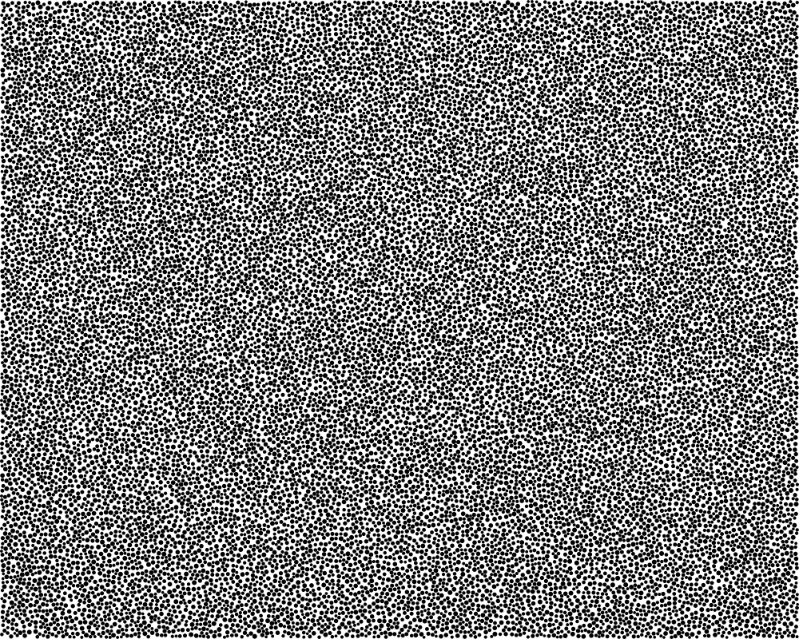

# specklegen-ac

## General

`specklegen-ac` generates synthetic speckle patterns for use in imaging and
analysis workflows. It creates randomly sized, non-overlapping dots on a
configurable canvas, targeting a specified area coverage. The dot and
background colors can be either black or white.

Each call produces:

- A TIFF image saved to `output_path`, at the requested image dimensions and
  export resolution.
- A Matplotlib preview, displayed after export. The preview includes the
  dot count and actual area coverage with true size visualisations.
- A `(figure, axis, stats)` return value for further use in Python. The
  `stats` dictionary contains `dot_count`, `dot_density` (dots per pixel
  squared), and `actual_coverage`.

The default exported pattern and its Matplotlib preview are shown below.

**Example exported image:**



**Example Matplotlib preview:**


### Parameters

| Parameter | Description | Default Value |
| --- | --- | --- |
| `image_height` | Image height in pixels. | `800` |
| `image_width` | Image width in pixels. | `1000` |
| `maximum_speckle_diameter` | Largest dot diameter in pixels. | `6` |
| `image_resolution` | Export resolution in pixels per mm. | `800 / 25.4` |
| `speckle_size_randomness` | Variation in dot size from 0 (uniform) up to, but not including, 1. | `0.4` |
| `speckle_target_coverage` | Fraction of image area covered by dots; must be strictly between 0 and 1. | `0.50` |
| `dot_color` | `"black"` or `"white"`; the background uses the opposite color. | `"black"` |
| `output_path` | Destination path for the exported TIFF. | `"speckle_pattern.tif"` |
| `rng` | Optional NumPy `Generator` for reproducible patterns. | `None` |

## Install

From the project directory, install the package and its dependencies:

```bash
python -m pip install .
```

For development and tests:

```bash
python -m pip install -e ".[test]"
pytest
```

## Use

```python
from specklegen_ac import create_speckle_image

figure, axis, stats = create_speckle_image(
    image_height=800,
    image_width=1000,
    maximum_speckle_diameter=6,
    speckle_target_coverage=0.5,
    output_path="speckle_pattern.tif",
)
```

All parameters have defaults; run `specklegen-ac` or `python -m specklegen_ac`
to generate a default pattern in the current directory.

## Package layout

- `generator.py`: public API, validation, and orchestration.
- `_placement.py`: speckle sizing and non-overlapping placement.
- `_rendering.py`: preview and TIFF rendering.
- `__init__.py`: stable package-level import.
- `tests/`: placement and public API tests.